# 3D-printed-artificial-horizon
Use black PLA for 3D print. Use a colour laser printer to print the attached PDF with graphics on a sticker and put it onto your print.
Add any 9-gram RC servos (eg. HXT900) to move the horizon. You can also add a white LED for illumination.
Good luck with your build!

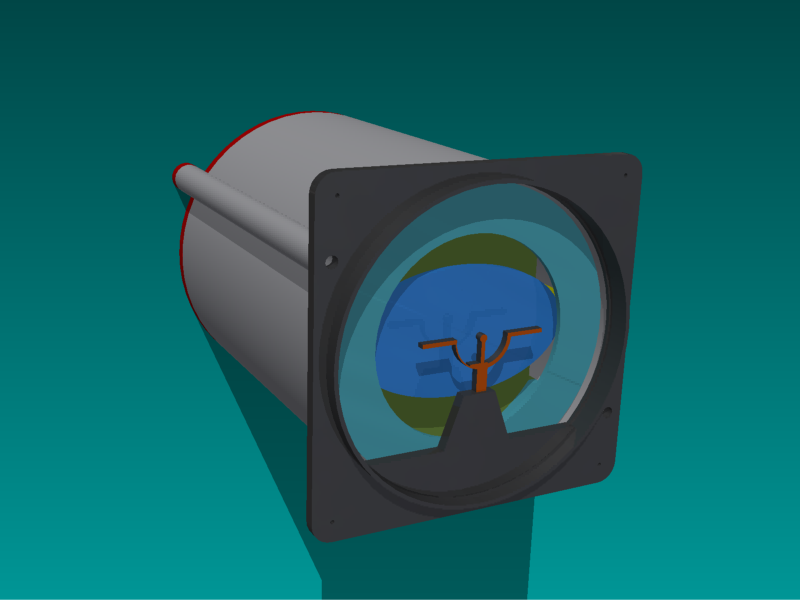

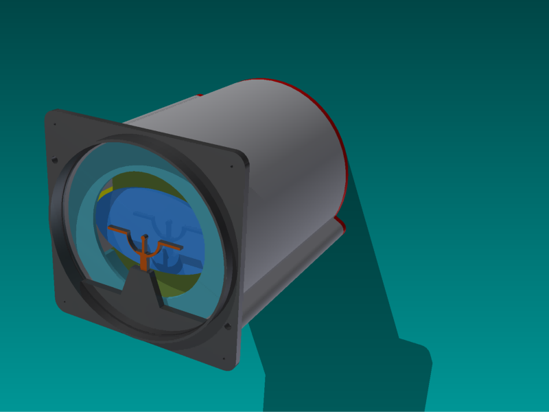

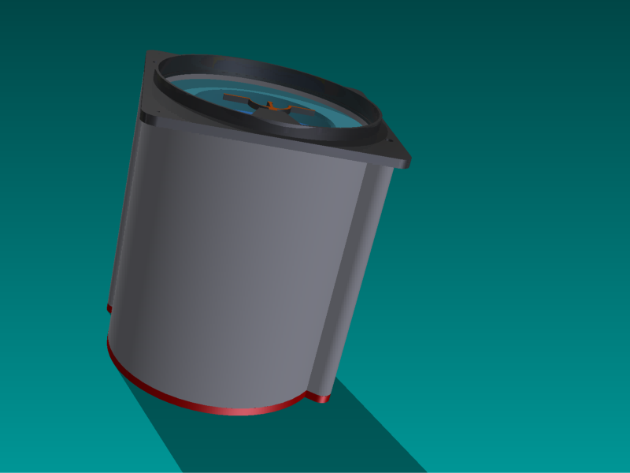

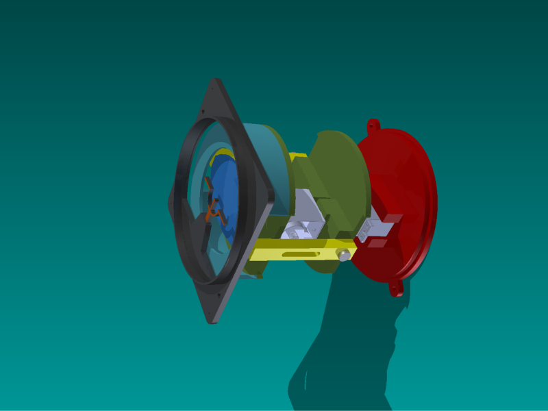

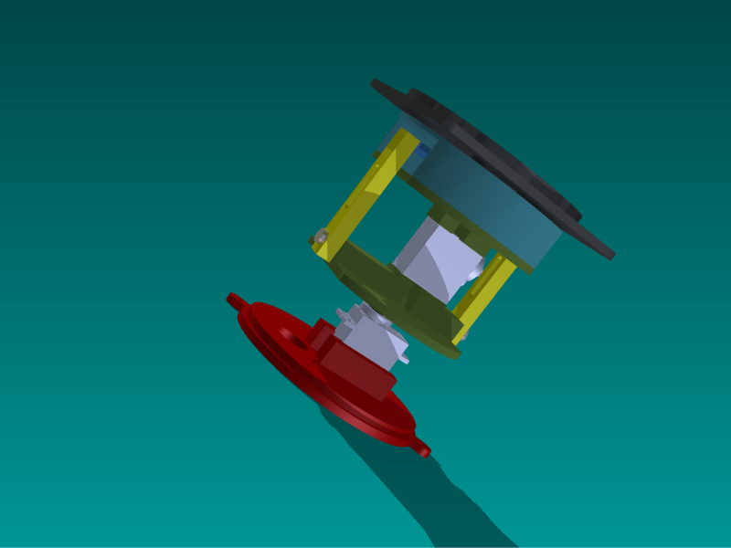

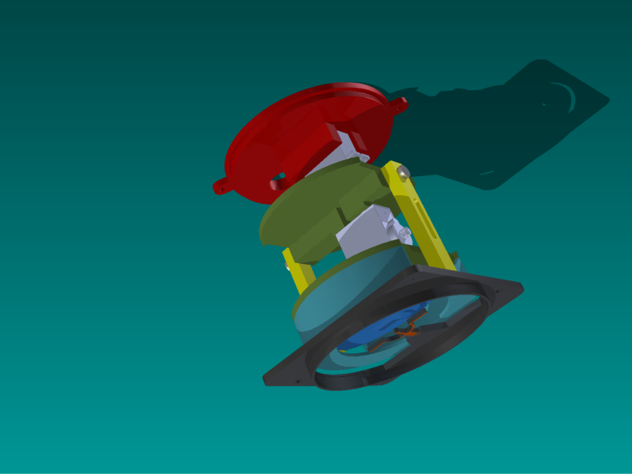

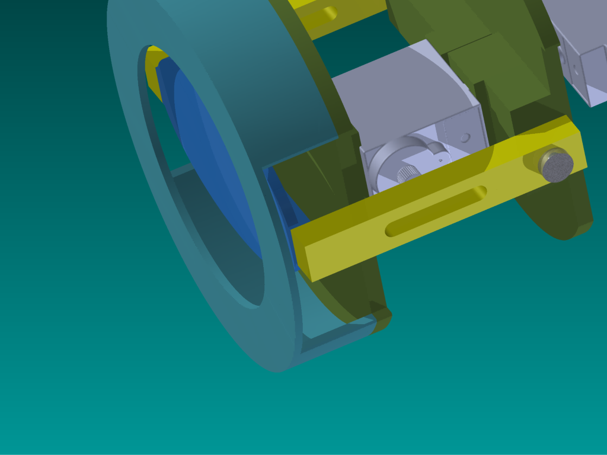

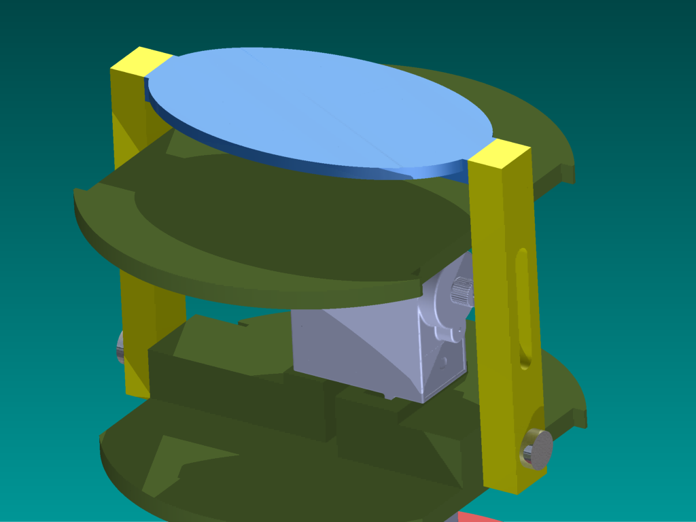

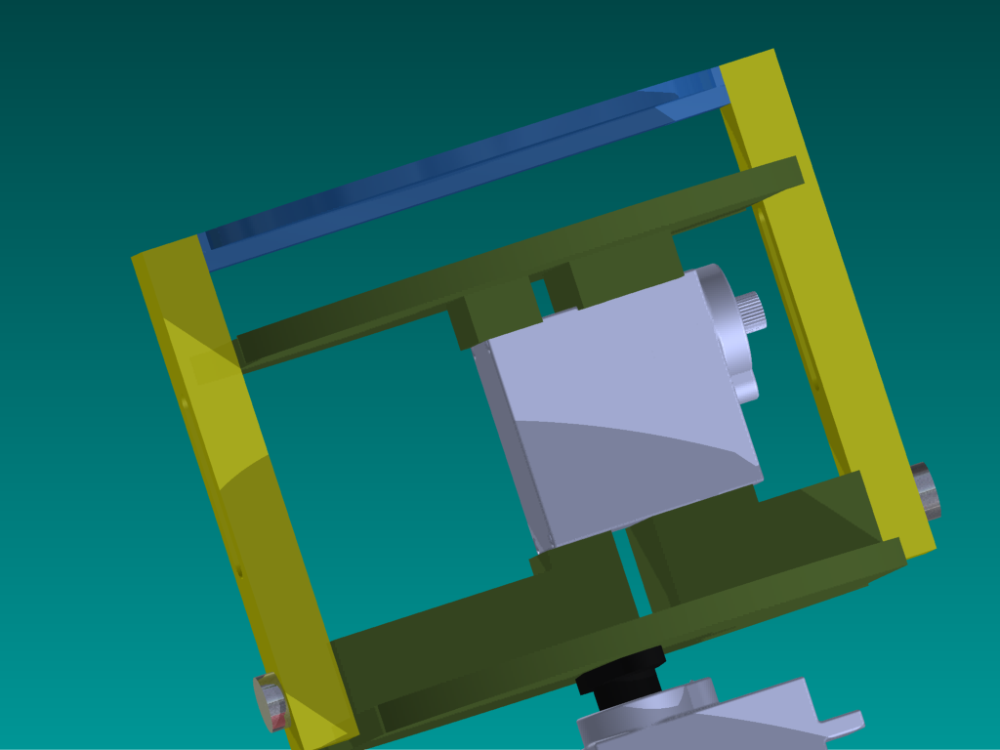

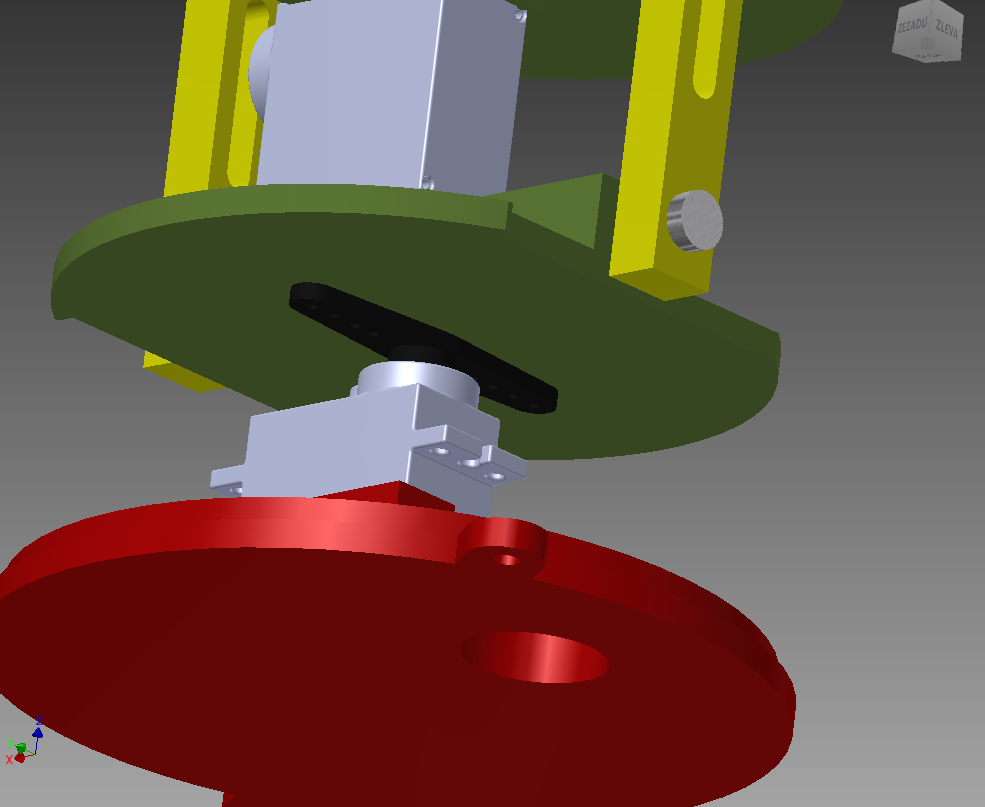

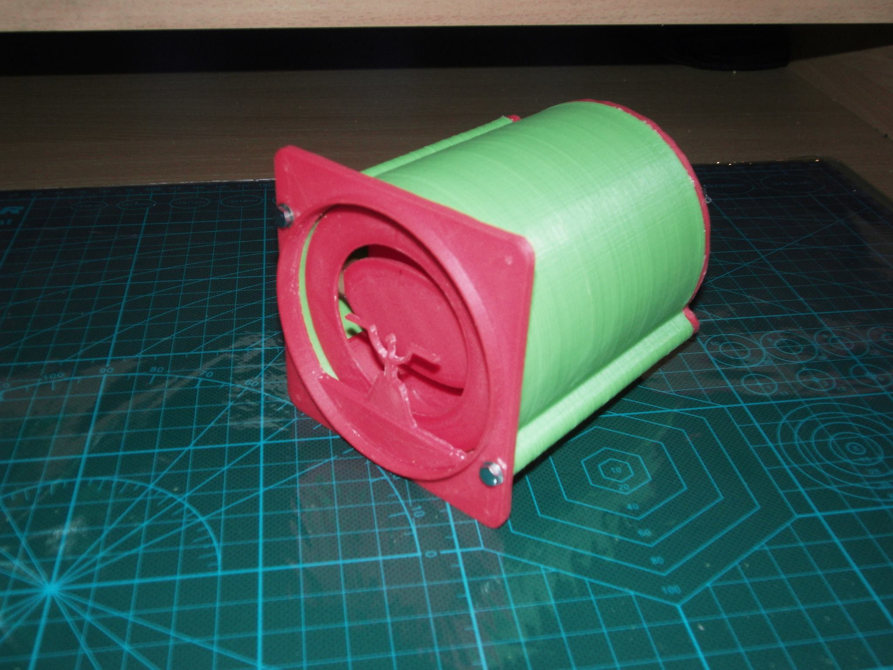

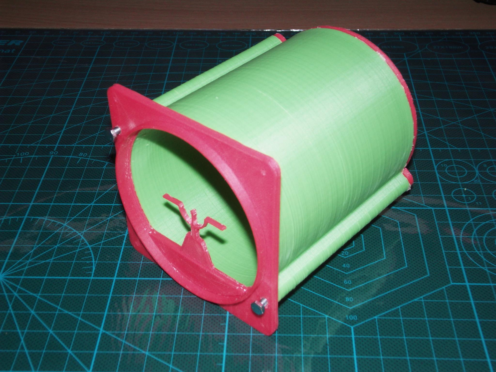
